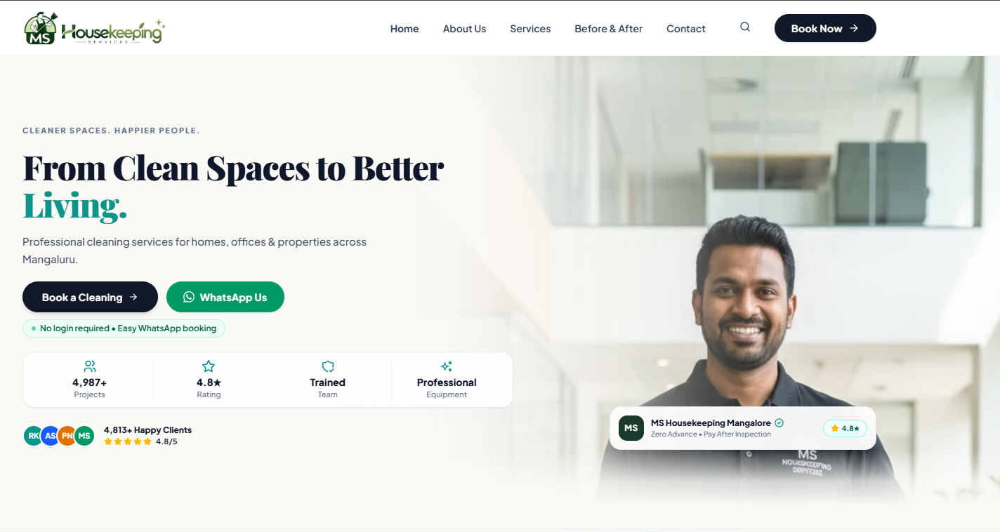
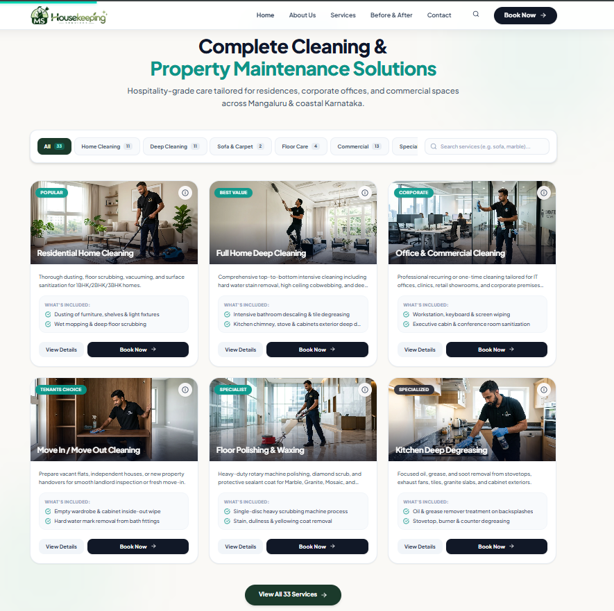
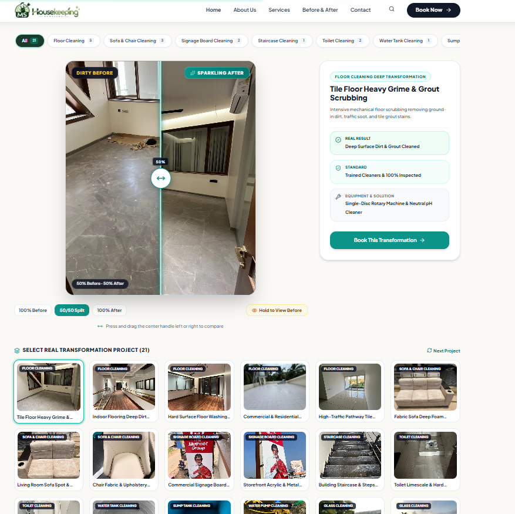
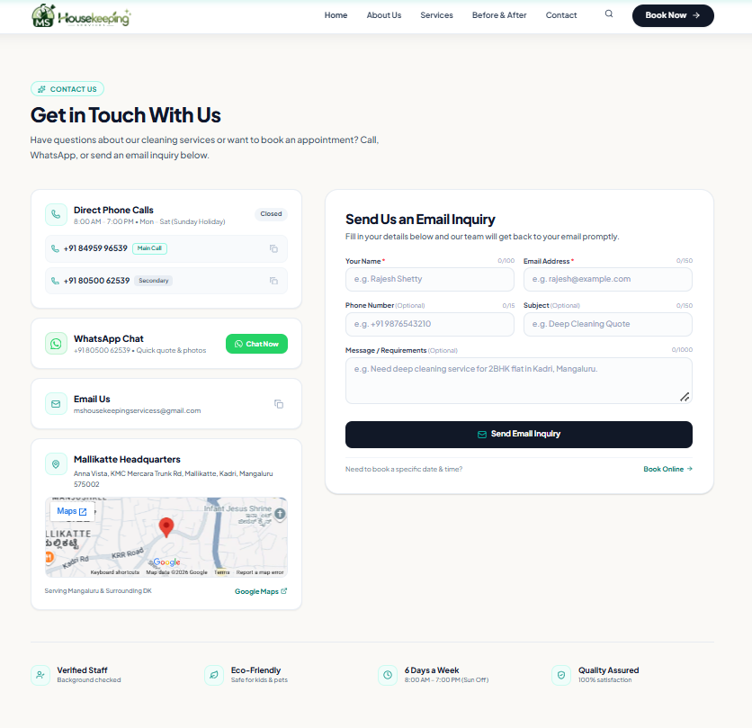

# MS Housekeeping Services

### Client Project | Website Development

A modern, responsive website developed for MS Housekeeping Services to showcase housekeeping solutions and make it easier for customers to explore services and submit enquiries.

**Live Website:** https://mshousekeeping.com

---

## Project Overview

MS Housekeeping Services is a business website designed to present housekeeping services through a clean, user-friendly interface. The website focuses on service discovery, customer enquiries and convenient WhatsApp-based booking.

## Key Features

- Responsive design for desktop, tablet and mobile devices.
- Modern user interface with smooth animations.
- Service catalogue with 33 housekeeping services.
- WhatsApp-based booking and enquiry workflow.
- Contact and enquiry form integration.
- Google Maps integration.
- Customer testimonials and reviews section.
- SEO-friendly website structure.

## Technologies Used

| Category | Technologies |
|---|---|
| Frontend | React, TypeScript |
| Styling | Tailwind CSS |
| Build Tool | Vite |
| Icons | Lucide React |
| Animations | Motion |
| Forms | Web3Forms |
| Deployment | Vercel |

## My Role & Contributions

- Developed the website interface and responsive layouts.
- Implemented reusable React components.
- Integrated WhatsApp-based booking functionality.
- Implemented contact and enquiry forms.
- Worked on website SEO and performance optimization.
- Integrated Google Maps and customer review sections.
- Implemented website security improvements.

## Project Preview

Visit the live website:

https://mshousekeeping.com

## Project Screenshots

### Screenshot 1

### Screenshot 2

### Screenshot 3

### Screenshot 4

## Project Information

- **Project Type:** Client Project
- **Role:** Website Developer
- **Status:** Deployed
- **Source Code:** Maintained in the client's private GitHub repository.

---

*Developed as a real-world client project to gain practical experience in web development and deployment.*
